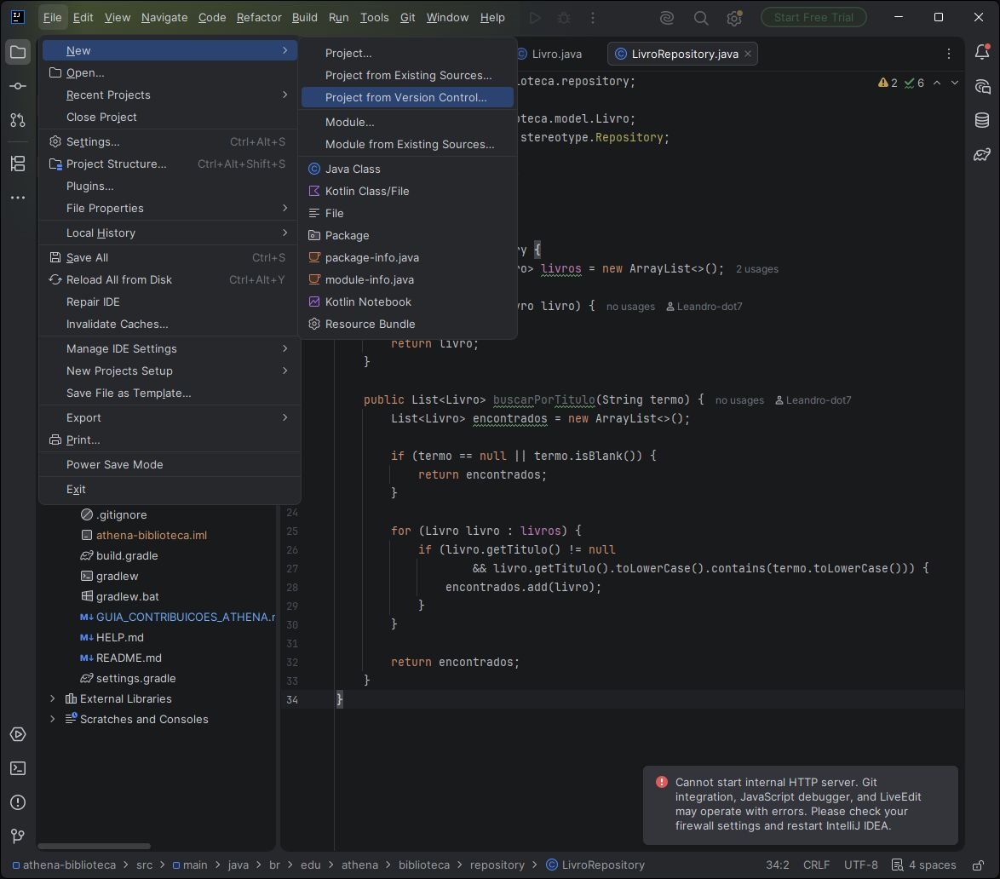
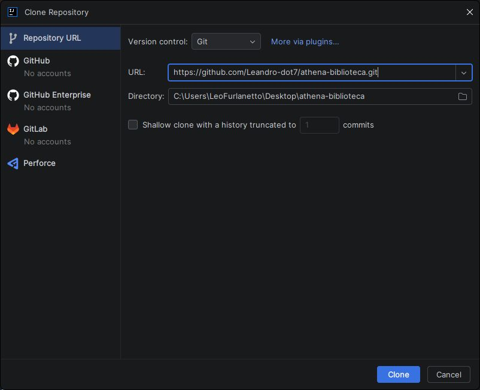
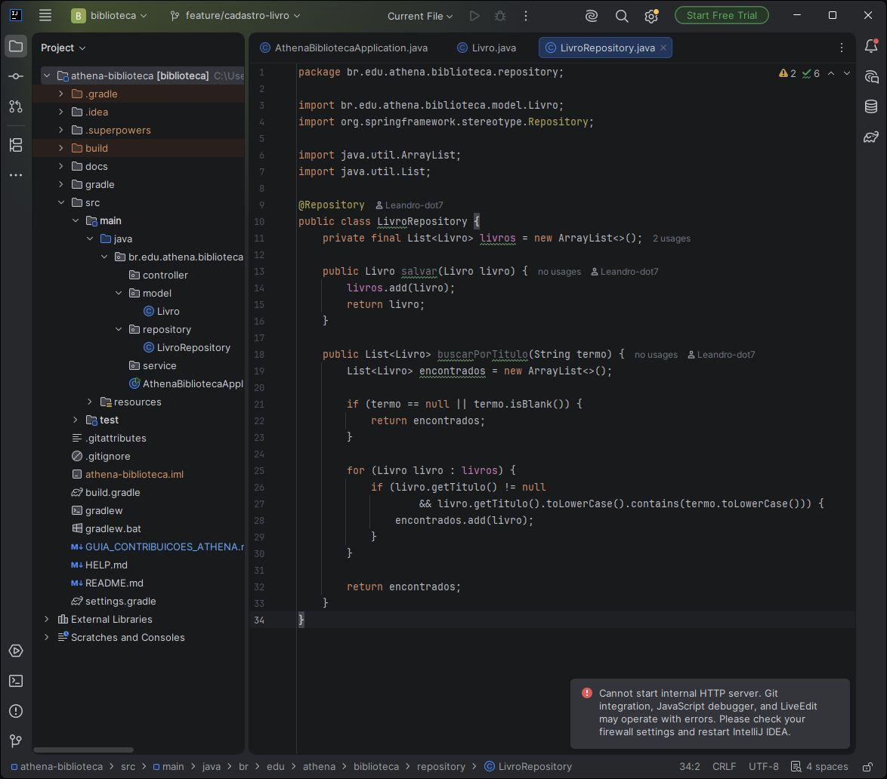
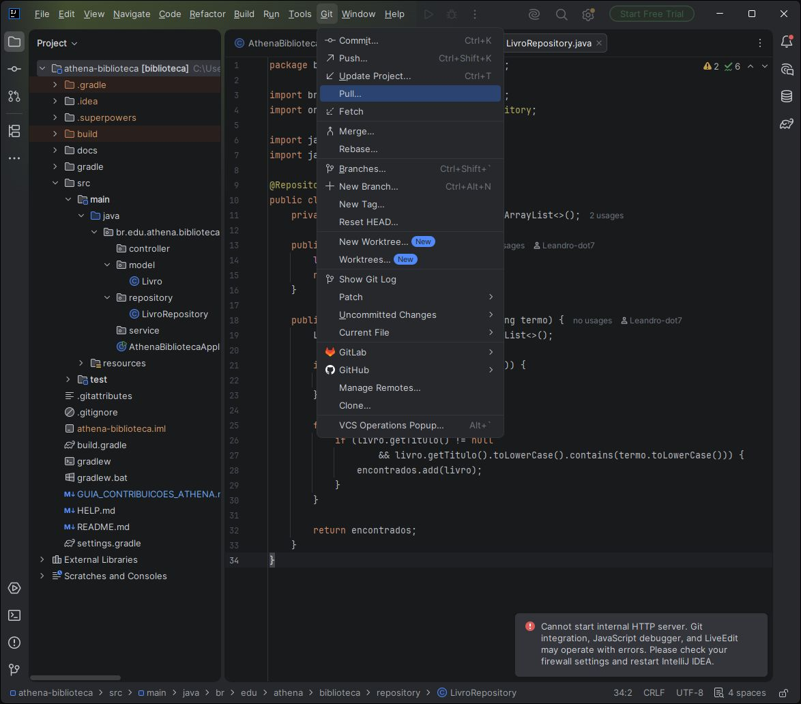
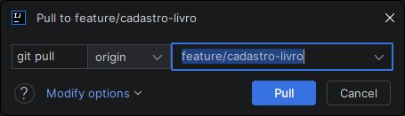

# Guia de contribuição — Sistema Athena Biblioteca

Repositório: https://github.com/Leandro-dot7/athena-biblioteca  
Quadro do projeto: https://github.com/users/Leandro-dot7/projects/1/views/1  
Branch de trabalho desta entrega: **feature/cadastro-livro**  
Branch de destino do Pull Request: **main**

Este guia cobre a primeira entrega do backlog: **Cadastro de livro (issue #1)**. No quadro, a issue #1 está em **In progress** e as issues #2 a #8 permanecem em **Backlog** para etapas futuras. Elas não são consideradas concluídas por este primeiro PR.

## Situação atual

- O repositório Athena está público e contém as oito issues do backlog.
- O quadro “Athena” está vinculado ao repositório Athena e exibe as oito issues.
- O quadro “Athena” é privado; Clênio, Isadora, Gabrielle e Northon já têm acesso a ele com permissão Write. O repositório público mostra o quadro na aba **Projects**, mas o conteúdo continua visível apenas a quem tem acesso ao projeto.
- Os convites de acesso para Clênio, Isadora, Gabrielle e Northon foram enviados e ainda aguardam aceite. Cada pessoa precisa aceitar o convite para poder publicar alterações.
- As oito issues duplicadas do projeto antigo foram fechadas. O histórico delas foi preservado no repositório antigo.
- O primeiro commit do Leandro já está publicado na branch **feature/cadastro-livro**; o item #1 está em **In progress** porque essa é a entrega atual.
- O PR ainda deve ser aberto depois que os quatro commits dos alunos estiverem publicados.

### Estado atual do quadro e backlog

A issue #1 (**Cadastro de livro**) está em **In progress**. As issues #2 a #8 estão em **Backlog**, e a coluna **Ready** está vazia. A coluna Backlog está configurada com limite 5; após mover a issue #1 para In progress, o quadro mostra **7/5** itens no Backlog.

| Issue | História | Prioridade | Situação nesta entrega |
|---|---|---:|---|
| [#1 Cadastro de livro](https://github.com/Leandro-dot7/athena-biblioteca/issues/1) | Cadastrar livros e encontrá-los na busca | Alta | **In progress** — entrega atual |
| [#2 Locação de livros](https://github.com/Leandro-dot7/athena-biblioteca/issues/2) | Registrar empréstimo de livro | Alta | Backlog — próxima etapa |
| [#3 Busca de livro](https://github.com/Leandro-dot7/athena-biblioteca/issues/3) | Pesquisar e mostrar disponibilidade | Alta | Backlog — próxima etapa |
| [#4 Cadastro do locatário](https://github.com/Leandro-dot7/athena-biblioteca/issues/4) | Cadastrar a pessoa que fará locações | Alta | Backlog — próxima etapa |
| [#5 Atualização de status](https://github.com/Leandro-dot7/athena-biblioteca/issues/5) | Alterar e consultar status de locação | Média | Backlog — próxima etapa |
| [#6 Devolução de livros](https://github.com/Leandro-dot7/athena-biblioteca/issues/6) | Registrar devolução e eventual multa | Média | Backlog — próxima etapa |
| [#7 Extensão do prazo](https://github.com/Leandro-dot7/athena-biblioteca/issues/7) | Estender o prazo de uma locação | Alta | Backlog — próxima etapa |
| [#8 Multa de atraso](https://github.com/Leandro-dot7/athena-biblioteca/issues/8) | Calcular multa por atraso | Média | Backlog — próxima etapa |

## O que já existe no código

A estrutura já criada pelo Leandro inclui:

- **src/main/java/br/edu/athena/biblioteca/model/Livro.java**: classe com título, autor e quantidade.
- **src/main/java/br/edu/athena/biblioteca/repository/LivroRepository.java**: guarda livros em uma lista enquanto a aplicação está ligada; possui os métodos salvar e buscarPorTitulo.
- Aplicação Spring Boot com Java 21, Gradle e dependência Web MVC.
- Teste inicial de carregamento da aplicação. Ainda faltam testes das regras de cadastro.

O repositório é temporário em memória. Ao desligar a aplicação, os livros cadastrados são perdidos. Persistência em banco de dados não faz parte desta primeira entrega, salvo orientação diferente do professor.

## Divisão dos quatro commits

| Commit | Integrante | O que criar |
|---|---|---|
| 1 — já publicado | Leandro (@Leandro-dot7) | Estrutura inicial, model Livro e LivroRepository |
| 2 | Isadora (@Doradrigues) | LivroService e validações do cadastro |
| 3 | Gabrielle (@Gabrielle-Corteze) | LivroController com operações HTTP de cadastro e busca |
| 4 | Northon (@NorthonCoelho) | Testes unitários do serviço de cadastro e busca |

**Clênio Silva (@cleniosilva) será o revisor do PR**, não um dos quatro autores dos commits. Cada aluno deve usar a própria conta GitHub e sua própria identidade Git.

## Antes de começar: esclarecer a issue #1

A issue exige quantidade maior ou igual a 1, validação de campos obrigatórios e que o livro cadastrado apareça na busca. Ela não diz quais campos são obrigatórios. O exemplo abaixo considera **título e autor** obrigatórios porque são os dados de texto existentes no model. Confirmem essa decisão com o professor antes de tratá-la como requisito definitivo.

A issue também menciona desabilitar o botão Salvar. O projeto atual não tem interface visual; por isso, o código abaixo valida no servidor e retorna erro HTTP 400 quando os dados são inválidos. Um botão desabilitado só poderá ser feito quando existir uma tela. Se o professor exigir exatamente o botão, confirmem qual interface deverá ser criada.

## Commit 2 — Isadora: criar o serviço

O serviço contém as regras do cadastro. Ele valida os dados antes de mandar o repositório salvar o livro.

### No IntelliJ

1. Aguarde o Leandro informar que o commit inicial está publicado.
2. Abra o projeto clonado no IntelliJ e atualize a branch conforme a seção “Trabalhar na branch compartilhada”.
3. No painel **Project**, clique com o botão direito em **src/main/java/br/edu/athena/biblioteca**.
4. Selecione **New → Package** e crie o pacote **br.edu.athena.biblioteca.service**.
5. Clique com o botão direito nesse pacote, selecione **New → Java Class**, dê o nome **LivroService**.
6. Substitua o conteúdo criado pelo IntelliJ por este código:

~~~java
package br.edu.athena.biblioteca.service;

import br.edu.athena.biblioteca.model.Livro;
import br.edu.athena.biblioteca.repository.LivroRepository;
import org.springframework.stereotype.Service;

import java.util.List;

@Service
public class LivroService {
    private final LivroRepository livroRepository;

    public LivroService(LivroRepository livroRepository) {
        this.livroRepository = livroRepository;
    }

    public Livro cadastrar(Livro livro) {
        validar(livro);
        return livroRepository.salvar(livro);
    }

    public List<Livro> buscarPorTitulo(String termo) {
        return livroRepository.buscarPorTitulo(termo);
    }

    private void validar(Livro livro) {
        if (livro == null) {
            throw new IllegalArgumentException("Os dados do livro são obrigatórios.");
        }

        if (livro.getTitulo() == null || livro.getTitulo().isBlank()) {
            throw new IllegalArgumentException("Informe o título do livro.");
        }

        if (livro.getAutor() == null || livro.getAutor().isBlank()) {
            throw new IllegalArgumentException("Informe o autor do livro.");
        }

        if (livro.getQuantidade() < 1) {
            throw new IllegalArgumentException("A quantidade deve ser maior ou igual a 1.");
        }
    }
}
~~~

7. Confira os imports automáticos do IntelliJ. Não crie outra cópia de Livro ou LivroRepository.
8. Faça o commit com a mensagem **feat: adiciona regras de cadastro de livros** e publique a branch.

### O que o serviço faz

- Rejeita livro nulo.
- Rejeita título ou autor vazio, conforme a suposição que deve ser confirmada com o professor.
- Rejeita quantidade zero ou negativa.
- Só chama salvar depois que os dados passam pela validação.
- Encaminha a busca para o repositório.

## Commit 3 — Gabrielle: criar o controlador

O controlador transforma chamadas HTTP em chamadas ao serviço. Não coloque regras de validação dentro dele; elas ficam no LivroService.

### No IntelliJ

1. Aguarde a Isadora publicar o commit.
2. Atualize sua branch compartilhada conforme a seção “Trabalhar na branch compartilhada”.
3. Em **src/main/java/br/edu/athena/biblioteca**, crie o pacote **br.edu.athena.biblioteca.controller**.
4. Dentro do pacote, crie a classe **LivroController**.
5. Use o código abaixo:

~~~java
package br.edu.athena.biblioteca.controller;

import br.edu.athena.biblioteca.model.Livro;
import br.edu.athena.biblioteca.service.LivroService;
import org.springframework.http.HttpStatus;
import org.springframework.http.ResponseEntity;
import org.springframework.web.bind.annotation.*;

import java.util.List;

@RestController
@RequestMapping("/livros")
public class LivroController {
    private final LivroService livroService;

    public LivroController(LivroService livroService) {
        this.livroService = livroService;
    }

    @PostMapping
    public ResponseEntity<Livro> cadastrar(@RequestBody Livro livro) {
        Livro cadastrado = livroService.cadastrar(livro);
        return ResponseEntity.status(HttpStatus.CREATED).body(cadastrado);
    }

    @GetMapping
    public ResponseEntity<List<Livro>> buscarPorTitulo(
            @RequestParam("titulo") String titulo) {
        return ResponseEntity.ok(livroService.buscarPorTitulo(titulo));
    }

    @ExceptionHandler(IllegalArgumentException.class)
    public ResponseEntity<String> tratarDadosInvalidos(
            IllegalArgumentException erro) {
        return ResponseEntity.badRequest().body(erro.getMessage());
    }
}
~~~

6. O POST em **/livros** cadastra um livro e responde com HTTP 201. O GET em **/livros?titulo=termo** procura pelo título e responde com HTTP 200.
7. Faça o commit com a mensagem **feat: cria endpoints de livros** e publique a branch.

### Conferência manual da API

Depois que os commits de serviço e controller estiverem publicados, qualquer integrante pode iniciar a aplicação pelo IntelliJ: abra **AthenaBibliotecaApplication** e clique no triângulo verde ao lado do método **main**.

Para cadastrar um livro, envie um POST para **http://localhost:8080/livros** com este JSON:

~~~json
{
  "titulo": "O Hobbit",
  "autor": "J. R. R. Tolkien",
  "quantidade": 3
}
~~~

Para buscar pelo título, envie um GET para **http://localhost:8080/livros?titulo=Hobbit**. A resposta deve conter o livro cadastrado enquanto a mesma aplicação estiver rodando.

Se os dados forem inválidos, a API deve responder HTTP 400 com a mensagem retornada pelo serviço. Esta API não cria uma tela nem um botão Salvar.

## Commit 4 — Northon: criar os testes do serviço

Os testes abaixo criam um repositório e serviço em memória, sem precisar iniciar o servidor.

### No IntelliJ

1. Aguarde a Gabrielle publicar o commit.
2. Atualize a branch compartilhada.
3. Em **src/test/java/br/edu/athena/biblioteca**, crie o pacote **br.edu.athena.biblioteca.service**.
4. Dentro dele, crie a classe **LivroServiceTest**.
5. Cole os testes:

~~~java
package br.edu.athena.biblioteca.service;

import br.edu.athena.biblioteca.model.Livro;
import br.edu.athena.biblioteca.repository.LivroRepository;
import org.junit.jupiter.api.Test;

import java.util.List;

import static org.junit.jupiter.api.Assertions.*;

class LivroServiceTest {
    private final LivroRepository livroRepository = new LivroRepository();
    private final LivroService livroService = new LivroService(livroRepository);

    @Test
    void deveCadastrarLivroComDadosValidos() {
        Livro livro = new Livro("O Hobbit", "J. R. R. Tolkien", 3);

        Livro resultado = livroService.cadastrar(livro);

        assertEquals("O Hobbit", resultado.getTitulo());
        assertEquals(3, resultado.getQuantidade());
    }

    @Test
    void naoDeveCadastrarLivroComQuantidadeMenorQueUm() {
        Livro livro = new Livro("O Hobbit", "J. R. R. Tolkien", 0);

        assertThrows(IllegalArgumentException.class,
                () -> livroService.cadastrar(livro));
    }

    @Test
    void naoDeveCadastrarLivroSemTitulo() {
        Livro livro = new Livro(" ", "J. R. R. Tolkien", 1);

        assertThrows(IllegalArgumentException.class,
                () -> livroService.cadastrar(livro));
    }

    @Test
    void livroCadastradoDeveAparecerNaBusca() {
        livroService.cadastrar(
                new Livro("Alice no País das Maravilhas", "Lewis Carroll", 2));

        List<Livro> encontrados =
                livroService.buscarPorTitulo("Alice");

        assertEquals(1, encontrados.size());
        assertEquals("Alice no País das Maravilhas",
                encontrados.get(0).getTitulo());
    }
}
~~~

6. Execute **LivroServiceTest** pelo triângulo verde ao lado do nome da classe. Também pode abrir a aba **Gradle → Tasks → verification → test**.
7. Se os testes falharem, leia a primeira mensagem de erro, corrija o problema e execute novamente.
8. Faça o commit com a mensagem **test: cobre cadastro e busca de livros** e publique a branch.

O teste de título vazio deve ser alterado se o professor não confirmar que título é obrigatório. Criem testes para autor vazio somente se essa regra também for confirmada.

## Trabalhar na branch compartilhada

[Veja os prints reais do IntelliJ para clonar, conferir a branch e fazer Pull.](#prints-reais-do-intellij)

Os quatro integrantes publicarão contribuições em sequência na mesma branch. Não trabalhem simultaneamente nela: aguardem o integrante anterior avisar que terminou o push.

### Primeiro uso de cada aluno

1. Aceite o convite do repositório enviado pelo GitHub. Sem aceitar, você poderá ler o repositório público, mas não conseguirá publicar commits.
2. No IntelliJ, selecione **File → New → Project from Version Control**.
3. Cole **https://github.com/Leandro-dot7/athena-biblioteca.git** e clique em **Clone**. O clone baixa uma cópia inicial do repositório.
4. Abra o Terminal integrado do IntelliJ e configure o nome e o e-mail da sua própria conta GitHub:

~~~bash
git config user.name "Seu nome"
git config user.email "seu-email-associado-ao-github"
~~~

5. **Antes de criar ou editar qualquer arquivo, faça Pull para trazer para o computador tudo que o grupo já publicou na branch compartilhada.** No terminal integrado do IntelliJ, execute:

~~~bash
git fetch origin
git switch --track origin/feature/cadastro-livro
git pull --ff-only origin feature/cadastro-livro
~~~

O **Clone** baixa a cópia inicial do repositório; o **Pull** atualiza sua branch com os commits mais recentes dos colegas. Se o IntelliJ já tiver criado a branch local **feature/cadastro-livro**, use **git switch feature/cadastro-livro** no lugar do comando com **--track** e depois execute o Pull.

### Antes de começar cada tarefa

**Faça Pull antes de criar ou editar arquivos.** Assim você baixa para a sua cópia local os commits publicados pelo integrante anterior. No terminal integrado do IntelliJ, execute:

~~~bash
git switch feature/cadastro-livro
git pull --ff-only origin feature/cadastro-livro
~~~

No IntelliJ, também pode usar **Git → Pull**, conferindo antes que a branch atual é **feature/cadastro-livro** e que a origem é **origin**.

**Fetch** atualiza a referência do que existe no GitHub. **Pull** baixa e incorpora esses commits na sua branch local. Para baixar o trabalho do grupo, use Pull; **Push não baixa arquivos**.

### Depois de implementar sua tarefa

1. Revise os arquivos modificados e execute os testes indicados na sua tarefa.
2. Faça seu commit pelo IntelliJ.
3. Só depois do commit, use **Git → Push** ou **Ctrl+Shift+K** para enviar sua contribuição ao GitHub. No terminal, o equivalente é:

~~~bash
git push origin feature/cadastro-livro
~~~

**Push envia seus commits locais para o GitHub.** Não use Push para tentar baixar o trabalho dos colegas. Se o Push for recusado porque o GitHub tem commits que você ainda não baixou, faça Pull, resolva qualquer conflito com o grupo e tente publicar novamente.

### Fazer commit e push pelo IntelliJ

1. Abra **Git → Commit** ou use **Ctrl+K**.
2. Confira a lista de arquivos. Inclua somente os arquivos relacionados à tarefa atribuída.
3. Não selecione **.idea/**, **.gradle/**, **build/** ou arquivos **.iml**.
4. Digite a mensagem indicada para o seu commit.
5. Clique em **Commit and Push**. Se aparecer apenas **Commit**, depois abra **Git → Push** ou use **Ctrl+Shift+K**.
6. Confirme no GitHub que o commit aparece em **feature/cadastro-livro** e avise o próximo integrante.

Se houver conflito ou o push for recusado, não force o push. Atualize a branch e peça ajuda ao grupo para resolver o conflito antes de continuar.

## Abrir o Pull Request

Depois que os quatro commits estiverem visíveis em **feature/cadastro-livro**:

1. No GitHub, abra o repositório e clique em **Compare & pull request**.
2. Confira a comparação: base **main**, compare **feature/cadastro-livro**.
3. No resumo, liste o serviço, os endpoints e os testes adicionados.
4. Peça revisão a **Clênio Silva (@cleniosilva)**.
5. Só inclua **Closes #1** se todos os critérios da issue tiverem sido atendidos. Como a issue menciona botão visual e não define os campos obrigatórios, confirme esses pontos com o professor antes de fechar a issue.
6. Abra o PR e compartilhe o link com os integrantes e o professor.

As issues #2 a #8 permanecem abertas para as próximas entregas. Depois deste PR, o grupo deve combinar a divisão delas antes de começar a próxima etapa.

## Prints reais do IntelliJ

As imagens abaixo foram feitas no IntelliJ do Leandro para mostrar onde clicar. A interface e os caminhos de pastas podem variar no computador de cada integrante.

### 1. Abrir a clonagem

No IntelliJ, abra **File → New → Project from Version Control**. Se estiver na tela inicial da IDE, use **Get from VCS**.

### 2. Informar a URL

Na janela **Clone Repository**, selecione **Repository URL** e cole `https://github.com/Leandro-dot7/athena-biblioteca.git`. Escolha uma pasta **vazia e própria do seu computador** em **Directory**; não use o caminho `C:\Users\LeoFurlanetto\...` mostrado na imagem, pois ele é apenas do computador do Leandro. Depois clique em **Clone**.

### 3. Conferir a branch e baixar as atualizações

Depois de clonar, entre na branch compartilhada `feature/cadastro-livro` conforme os comandos da seção **Primeiro uso de cada aluno**. Confira o nome da branch na barra superior do IntelliJ:

Antes de editar arquivos, abra **Git → Pull**:

Na janela, confira **origin** e **feature/cadastro-livro** e então clique em **Pull**. O Pull baixa os commits dos colegas; faça novamente antes de cada nova tarefa.

